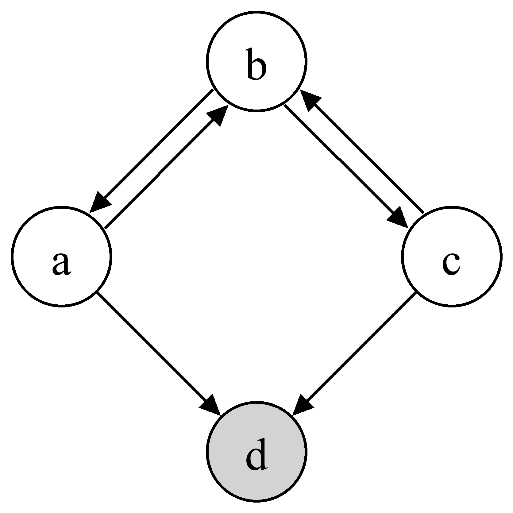
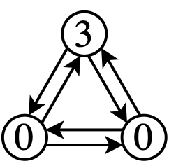
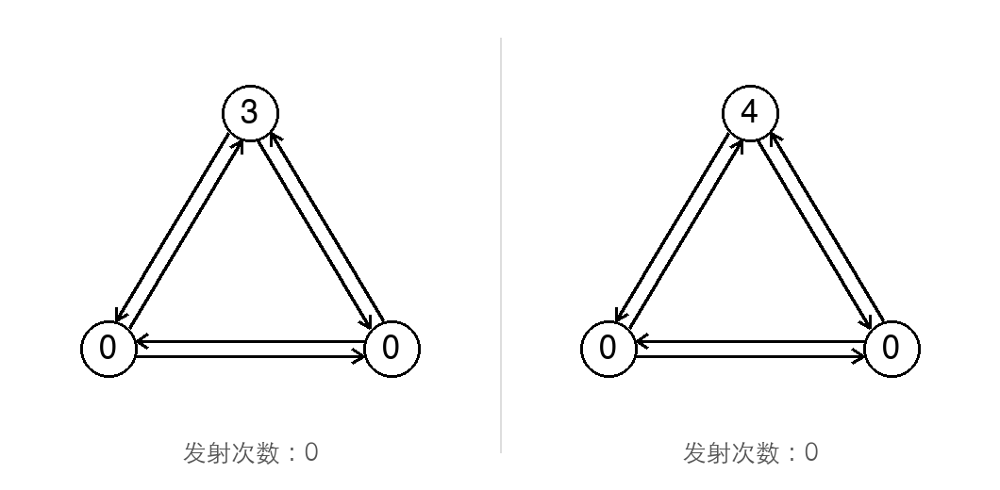
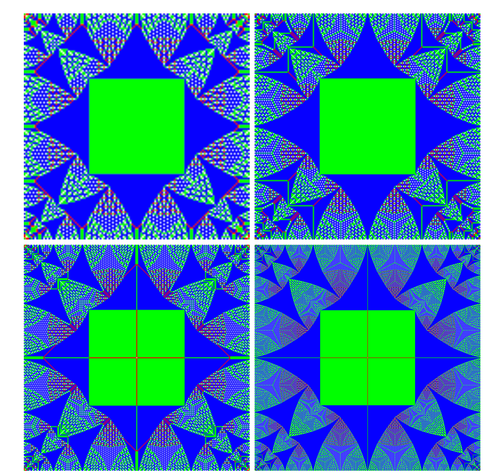
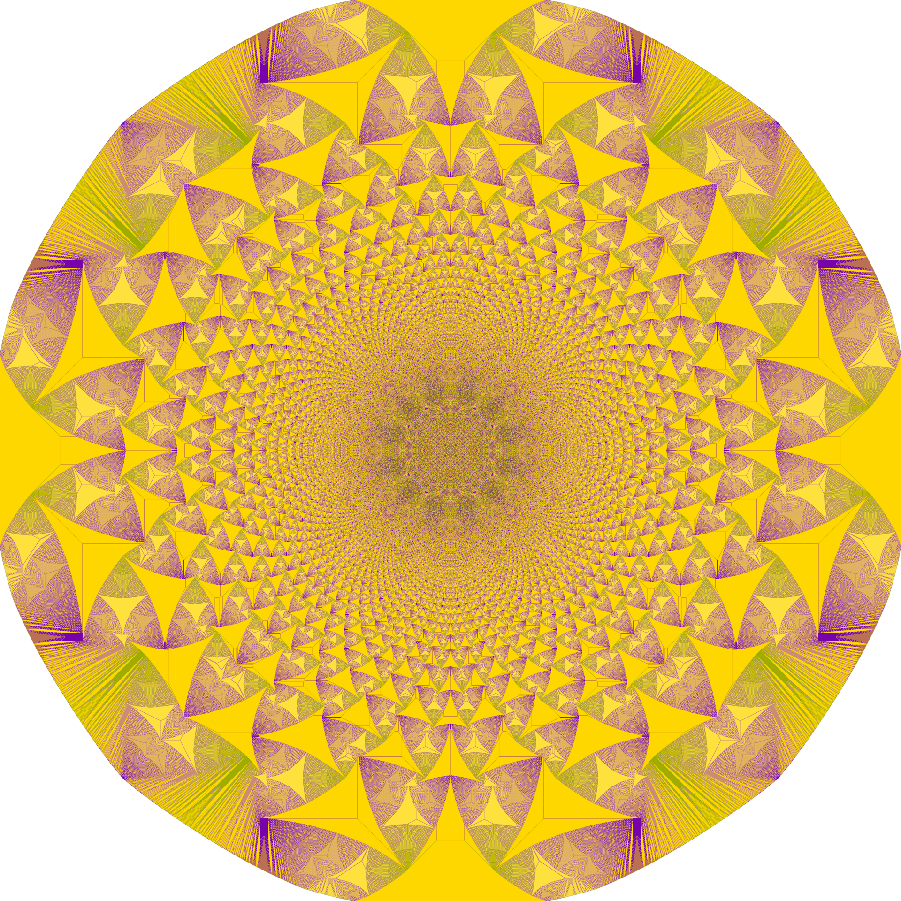
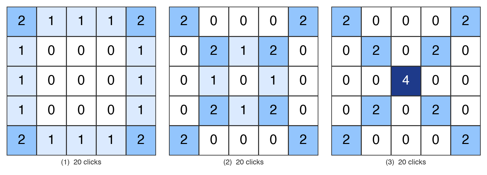
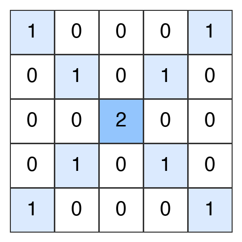
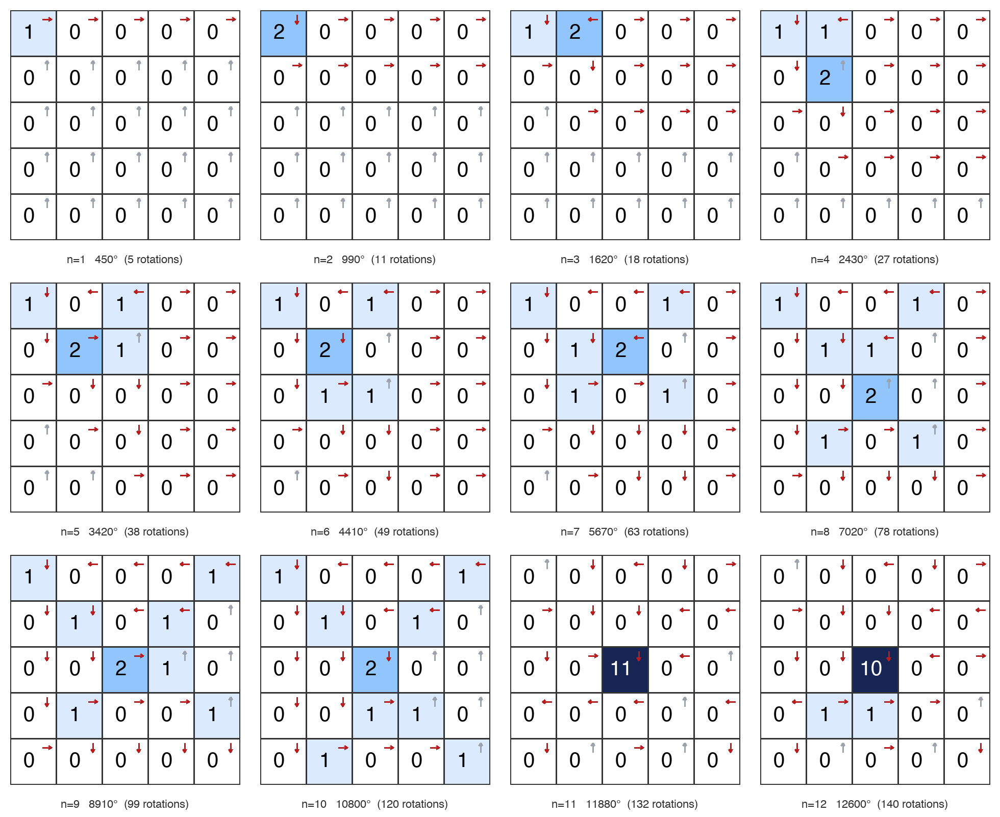
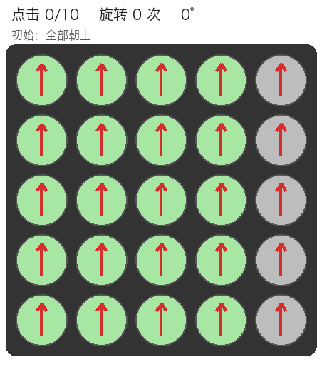

Introduction
=
There is a little game called "Ten Steps, Ten Thousand Degrees". It has a 5×5 array of dials, each with a pointer, all pointing up at the start.

When you click a dial, it turns 90 degrees clockwise. If the pointer then points at another dial, that dial also turns 90 degrees clockwise, and the chain reaction goes on until a pointer points off the board.

The goal is to make the dials turn a total of ten thousand degrees within 10 clicks, hence the name. I had an AI build an [online version](https://youhuali.github.io/ten-steps-ten-thousand-degrees/); you may want to play it first.

The game is quite hard, and reaching ten thousand degrees in ten steps is not easy. But while playing you soon notice a curious property: the score does not depend on the order of the clicks! A stronger statement holds: starting from the same position, take a click combination such as $(a_1,a_2,a_3,\cdots, a_{25})$, where $a_i$ is the number of clicks on the i-th dial. Whatever the order of the clicks, every dial ends up turning through the same number of degrees, so the final position is the same as well.

How do we prove this? You probably think of commutative groups. If we can model the game as a group and show that it is commutative, that is, abelian, then we have shown that the order of the clicks does not affect the result. Intuitively the elements of this group are the click positions, but the effect of a click clearly depends on the current position, so 25 elements alone cannot describe the game. We could take click combinations as the group elements instead, but each position can be clicked any number of times, so there are infinitely many click combinations and the group would be infinite, which seems to make things more complicated. So the key question becomes: how do we "merge" click combinations so that we end up with a finite group?

After some searching I found that mathematicians have studied two group models: the sandpile group and the rotor-router group. The latter can be seen as a special case of the former, and the rotor-router group fits the Ten Steps game perfectly. Below I introduce both groups and show how to analyze the game with group theory. You will see that the rotor-router group of this game has as many as $32{,}565{,}539{,}635{,}200$ elements. Despite that, its properties are all within reach of computation.

Once the game is modeled as a group, many questions about it can be answered. Besides the commutativity above: Can every position be reached from every other? Does clicking one cell over and over eventually restore the board? Is there a click combination that leaves the position unchanged? For every combination, is there another one that undoes it (brings the board back to where it was before)?

Once the game is a group, all of these questions fall into place.

The background below mainly follows a 2008 paper by six researchers, [Chip-Firing and Rotor-Routing on Directed Graphs](https://arxiv.org/abs/0801.3306). "The paper" below always means this one.

The first half introduces the definitions and some properties of the sandpile group and the rotor-router group. For easy cross-reference, lemmas and theorems carry the same numbers as in the paper. Proofs are mostly omitted; if you are interested, read the paper directly. The second half uses the rotor-router group to analyze Ten Steps and answer some fun questions about the game.

This is a very long article, and inevitably a lot of the text was generated by AI, so please bear with it. The AI-generated parts are full of substance; read them patiently and you will get something out of them.


The sandpile group
=
Let us define a "chip-firing" game. It is played on a graph in the sense of graph theory, so here is a quick list of the graph-theory terms we will need.

Graph: a set of vertices and edges.

Directed graph: the edges have directions.

Out-degree: the number of edges leaving a vertex.

In-degree: the number of edges entering a vertex.

Sink: a vertex with out-degree 0.

Global sink: a sink that can be reached from every other vertex by following edges. In this article we require the global sink to be unique.

Bidirected graph: whenever A and B are adjacent, there is one edge from A to B and one from B to A. In this article, if a graph becomes bidirected after removing its global sink, we call it a bidirected graph with a global sink.



The figure above is an example of a bidirected graph with a global sink; d is the global sink.

Adjacency matrix: a common way to represent a graph as a matrix. It is the $n\times n$ matrix whose $(i,j)$ entry is the number of edges from $v_i$ to $v_j$.

Laplacian matrix: besides the adjacency matrix, the other common matrix representation of a graph. It is defined as follows.

If the graph has n vertices, its adjacency matrix is A, and D is the out-degree diagonal matrix, with each vertex's out-degree on the diagonal, then its Laplacian matrix $\Delta$ is:

$$\Delta = D - A$$

For example, in the graph above the out-degrees are: a 2, b 2, c 2, d 0.

Reachability: a and c point directly to d, and b reaches d through a or c, so d is the global sink.

With rows a, b, c, d from top to bottom, A, D and $\Delta$ are this graph's adjacency matrix, out-degree diagonal matrix and Laplacian matrix:

$$
A=\begin{pmatrix}
0 & 1 & 0 & 1\\
1 & 0 & 1 & 0\\
0 & 1 & 0 & 1\\
0 & 0 & 0 & 0
\end{pmatrix},
\qquad
\qquad
D=\begin{pmatrix}
2 & 0 & 0 & 0\\
0 & 2 & 0 & 0\\
0 & 0 & 2 & 0\\
0 & 0 & 0 & 0
\end{pmatrix},
$$

$$
\Delta=D-A=\begin{pmatrix}
 2 & -1 &  0 & -1\\
-1 &  2 & -1 &  0\\
 0 & -1 &  2 & -1\\
 0 &  0 &  0 &  0
\end{pmatrix}.
$$

A notable feature of the Laplacian is that every row sums to 0, because the diagonal entry cancels the others. If we delete the row and column of the global sink, the resulting matrix is called the "reduced Laplacian", usually written $\Delta^\prime$:

$$
\Delta'=\begin{pmatrix}
 2 & -1 &  0\\
-1 &  2 & -1\\
 0 & -1 &  2
\end{pmatrix},
$$

This reduced Laplacian will be very useful later.

Now we define a chip-firing game on a bidirected graph. Imagine that each vertex holds some number of chips; such a state is called a "chip configuration". For example, the figure below shows a bidirected graph on 3 vertices, where one vertex has 3 chips and the other two have none:



If every non-sink vertex holds fewer chips than its out-degree, the configuration is called "stable"; otherwise it is unstable, or "active".

Define a "firing" operation:

In an unstable configuration, pick any vertex whose chip count is at least its out-degree, and "fire" one chip along each of its outgoing edges to the vertex it points to. In other words, if the vertex has out-degree n, it loses n chips and each vertex its edges point to gains 1 chip. Here is the firing process for two different configurations:



The first configuration becomes stable after 1 firing. The second never becomes stable, however you fire. Seeing this, you probably have a string of questions:

>Question 1: Which configurations become stable? Is there a way to tell?

There are indeed several criteria for stability, but only one matters for this article:

Lemma 2.4: If a bidirected graph G has a global sink, every chip configuration on G eventually becomes stable.

We skip the proof, but you can picture it: with a global sink, chips keep flowing into the sink and there are fewer and fewer of them, until the configuration is stable.

>Question 2: If there is a global sink and several vertices can fire at once, does the firing order affect the final stable configuration?

You may have guessed the answer: no! However you fire, you always end up in the same stable configuration. In fact there is a stronger result.

Define the "add a chip" operation: put one chip on a vertex of G, then fire until the configuration is stable.

Lemma 2.5: Adding chips is commutative.

Corollary 2.6: On a bidirected graph with a global sink, as long as each vertex receives the same number of chips, the order of adding them does not matter: after firing you always reach the same stable configuration.

In group theory "abelian" is a synonym for commutative, so this is called the "abelian property".

>Question 3: How many stable configurations can a bidirected graph with a global sink have?

Clearly there can be many, so we want a tool that describes how many there are and how they are structured. Fortunately, mathematicians found that these stable configurations form a group! The group is defined as a quotient group:

$S(G)=Z^{n-1}/Z^{n-1}\Delta ^\prime (G)$

$S(G)$ is called the sandpile group of the graph G. n is the number of vertices of G, so n-1 is the number of non-sink vertices.

The "numerator" of a quotient group is a group. Here $Z^{n-1}$ is the group of integer vectors of dimension n-1; its elements are row vectors of n-1 integers:

$(a_1, a_2, \cdots, a_{n-1})$. The group operation is componentwise addition, and the identity is the zero vector.

The "denominator" of a quotient group is a normal subgroup of the numerator. Here it is $Z^{n-1}\Delta ^\prime (G)$, where $\Delta ^\prime$ is the reduced Laplacian of G. The elements of this normal subgroup are all integer linear combinations of the rows of $\Delta ^\prime$.

This definition is rather abstract, so we need to understand what it means. Readers who know group theory know that a quotient group can be thought of as "collecting like terms" in the parent group (the one in the numerator). So what exactly does the sandpile group merge? And how many elements are left after merging?

As for the number of elements, Lemma 2.8 of the paper proves that it equals the determinant of $\Delta ^\prime$. For the earlier example,

$$
\Delta'=\begin{pmatrix}
 2 & -1 &  0\\
-1 &  2 & -1\\
 0 & -1 &  2
\end{pmatrix},
$$

its determinant is $\text{det} \Delta^\prime =4$, so the corresponding sandpile group has only 4 elements. We can work through this sandpile group in detail to get a concrete feel for what it means.

---
**A worked example of the sandpile group**


In the figure: non-sink vertices $a,b,c$, global sink $d$; edges $a\leftrightarrow b$, $b\leftrightarrow c$, $a\to d$, $c\to d$. All three non-sink vertices have out-degree 2. In the order $a,b,c$,

$$
\Delta'=\begin{pmatrix} 2&-1&0\\-1&2&-1\\0&-1&2\end{pmatrix},\qquad \det\Delta'=4,
$$

so the sandpile group has 4 elements and is the cyclic group $\mathbb{Z}_4$.

**Firing rule.** Write a chip configuration as $(s_a,s_b,s_c)$. A vertex with $\ge 2$ chips can fire: $a$ sends 1 chip to $b$ and 1 to $d$; $b$ sends 1 to $a$ and 1 to $c$; $c$ sends 1 to $b$ and 1 to $d$. Chips sent to $d$ disappear.

**Group elements.** The stable configurations have 0 or 1 chip on each vertex, 8 in all. Only 4 of them are recurrent (the meaning of "recurrent" is explained below), and those 4 are the group elements:

| Configuration $(s_a,s_b,s_c)$ | Order | Note |
|---|---|---|
| $(1,0,1)$ | 1 | identity $I$ |
| $(1,1,1)$ | 2 | |
| $(0,1,1)$ | 4 | generator, written $g$ |
| $(1,1,0)$ | 4 | $g^3=g^{-1}$ |

The other 4 stable configurations $(0,0,0),(1,0,0),(0,1,0),(0,0,1)$ are not recurrent and are not in the group.

**Group operation.** Add two configurations vertex by vertex, then fire repeatedly until stable; write this $(\sigma+\sigma')^\circ$. Below we walk through the whole group using powers of $g=(0,1,1)$, labeling each arrow with the vertex that fires:

$g^2=(g+g)^\circ$:

$$
(0,2,2)\xrightarrow{b}(1,0,3)\xrightarrow{c}(1,1,1).
$$

$g^3=(g^2+g)^\circ$:

$$
(1,2,2)\xrightarrow{b}(2,0,3)\xrightarrow{a}(0,1,3)\xrightarrow{c}(0,2,1)\xrightarrow{b}(1,0,2)\xrightarrow{c}(1,1,0).
$$

$g^4=(g^3+g)^\circ$:

$$
(1,2,1)\xrightarrow{b}(2,0,2)\xrightarrow{a}(0,1,2)\xrightarrow{c}(0,2,0)\xrightarrow{b}(1,0,1)=I.
$$

After four steps we are back at the identity, so $g$ has order 4 and the group is $\mathbb{Z}_4=\{I,g,g^2,g^3\}$.

**A few more checks.**

- The identity really leaves every element unchanged: $I+g=(1,1,2)\xrightarrow{c}(1,2,0)\xrightarrow{b}(2,0,1)\xrightarrow{a}(0,1,1)=g$.
- The element of order 2 squared gives the identity: $(1,1,1)+(1,1,1)=(2,2,2)$; firing $a,b,c,b,a,c,b$, 7 times in all, gives $(1,0,1)=I$.
- Mutually inverse elements multiply to the identity: $g+g^3=(0,1,1)+(1,1,0)=(1,2,1)$, which stabilizes to $(1,0,1)=I$, exactly as in the computation of $g^4$.

**Seen through the matrix.** The three rows of $\Delta'$ are $r_a=(2,-1,0)$, $r_b=(-1,2,-1)$, $r_c=(0,-1,2)$. Firing $v$ once subtracts $r_v$. The computation of $g^4$ above fired $a$ once, $b$ twice and $c$ once, so

$$
(1,2,1)-(1,0,1)=(0,2,0)=r_a+2r_b+r_c ,
$$

that is, the vector $4g=(0,4,4)$ for $g^4$ differs from $I=(1,0,1)$ by a vector in the row lattice, so the two are the same element of the quotient group $\mathbb{Z}^3/\mathbb{Z}^3\Delta'$. This is the correspondence between the two definitions: "addition plus stabilization on recurrent configurations" and "integer vectors modulo the row lattice of $\Delta'$".

---

After reading this, things should click into place! Put intuitively, the definition of the sandpile group says:

The elements of the sandpile group are equivalence classes of chip configurations. Two configurations are in the same class if and only if, after firing, they reach the same stable configuration. The group operation is to superimpose two configurations and fire until stable, where superimposing means adding the chip counts of one configuration to the corresponding vertices of the other.

A word more on "recurrent". The example above has 8 stable configurations, but 4 of them are special: they can only be reached from special starting configurations. Take the stable configuration (0,0,0): if there are many chips at the start, no amount of adding chips and firing can make all the chips disappear.

A configuration is called "accessible" if it can be reached from any configuration by adding chips and firing. Accessible stable configurations are called "recurrent". The authors of the paper prove that each element of the sandpile group, that is, each equivalence class of configurations, contains exactly one recurrent stable configuration, so these recurrent stable configurations are normally used as representatives of the group elements. When I said earlier that "each element of the sandpile group corresponds to a stable configuration", the accurate statement is "each element of the sandpile group corresponds to a **recurrent** stable configuration".

With the sandpile group in hand, we can solve some fun exercises about chip-firing. Here is an example the AI came up with:

---

**Q: Can the sandpile group quickly tell us the final stable configuration of, say, $(100,50,25)$? How do we find its equivalence class without simulating the firings one by one?**

Yes. This is exactly what the sandpile group is for: the class comes out of one linear-algebra computation, with no step-by-step firing. Three steps.

**Step 1: find a "class function".** The sandpile group is $\mathbb{Z}^3/\mathbb{Z}^3\Delta'$, which for this graph is isomorphic to $\mathbb{Z}_4$, so there is a homomorphism $\varphi:\mathbb{Z}^3\to\mathbb{Z}_4$ whose kernel is exactly the row lattice of $\Delta'$. Write $\varphi(\sigma)=w\cdot\sigma \bmod 4$ and require the dot product of $w$ with each row of $\Delta'$ to be a multiple of 4:

$$
r_a=(2,-1,0),\ r_b=(-1,2,-1),\ r_c=(0,-1,2)
\;\Longrightarrow\;
2w_a-w_b\equiv 0,\quad -w_a+2w_b-w_c\equiv 0,\quad -w_b+2w_c\equiv 0 \pmod 4 .
$$

The solution is $w=(1,2,3)$, so

$$
\varphi(s_a,s_b,s_c)=s_a+2s_b+3s_c \pmod 4 .
$$

Check against the four recurrent configurations: $I=(1,0,1)\mapsto 0$, $g=(0,1,1)\mapsto 1$, $g^2=(1,1,1)\mapsto 2$, $g^3=(1,1,0)\mapsto 3$. $\varphi$ sends each configuration straight to its element of $\mathbb{Z}_4$.

**Step 2: find the class of $(100,50,25)$.**

$$
\varphi(100,50,25)=100+100+75=275\equiv 3 \pmod 4 ,
$$

so it lies in the class of $g^3$, whose only recurrent configuration is $(1,1,0)$.

We still need to make sure that stabilization lands on this recurrent configuration and not on some non-recurrent stable configuration in the same class. The test is simple: $(100,50,25)\ge I=(1,0,1)$ holds vertex by vertex, so it is "the identity plus some chips", and adding chips to a recurrent configuration and stabilizing gives a recurrent configuration again. So the final stable configuration is $(1,1,0)$. Simulation agrees, with 284 firings in all.

**Step 3: even the number of firings can be computed directly.** Let $x_v$ be the number of times $v$ fires. Then $\sigma-\sigma^\circ=x\Delta'$, so

$$
x=(\sigma-\sigma^\circ)\,\Delta'^{-1},\qquad
\Delta'^{-1}=\frac14\begin{pmatrix}3&2&1\\2&4&2\\1&2&3\end{pmatrix}.
$$

Substituting $\sigma-\sigma^\circ=(99,49,25)$ gives $x=(105,111,68)$, 284 in total, exactly as in the simulation. The number of chips that flow into the sink is $x_a+x_c=173=175-2$, which also checks out.

**One necessary caveat.** $\varphi$ gives the equivalence class, but the stabilization $\sigma^\circ$ equals the recurrent representative of the class only when $\sigma$ is, vertex by vertex, at least some recurrent configuration. For example, the class of $(0,0,0)$ is 0, with representative $I=(1,0,1)$, but $(0,0,0)$ is already stable, so $\sigma^\circ=(0,0,0)$. This only happens when there are very few chips; a large configuration like $(100,50,25)$ is safe.

---

The sandpile model dates from 1987, when Per Bak, Chao Tang (born 1958, now a chair professor at Westlake University and Peking University) and Kurt Wiesenfeld introduced it in a paper on dynamical systems with self-organized criticality. Deepak Dhar later found that the sandpile model is commutative and introduced the sandpile group.

One feature of the sandpile model is that at large scales it shows structures that organize themselves "spontaneously". Take a very large square "sandpile", that is, a square grid as the bidirected graph with every boundary vertex connected to one global sink. Its identity element looks like this:



Top left is 128×128, top right 198×198, bottom left 243×243, bottom right 521×521. Colors stand for numbers: orange = 0, red = 1, green = 2, blue = 3. The pictures show a rather mysterious kind of organized structure.

If we drop 30 million grains of sand at once at the origin of an infinite grid and fire by the chip-firing rule until stable, we get the picture below (white 0 grains, green 1, purple 2, gold 3):



The rotor-router group
=

Having seen the sandpile group, you can probably sense that it resembles the Ten Steps game somehow, yet the two do not connect directly. So we bring in another notion, the "rotor-router group". The paper defines it as a permutation group acting on the set of all spanning trees rooted at the global sink. Let us go straight to the Ten Steps game as the example:

View the game as a directed graph $G$: the vertices are the 25 cells plus a sink $s$; each cell has 4 outgoing edges, to its neighbors above, right, below and left, and edges that leave the board point to $s$. So each cell has out-degree $d_v=4$, and the cyclic order of its outgoing edges is up→right→down→left. Every cell can reach $s$, so $s$ is the **global sink**.

Define the **chip-addition operator** $E_v$: put a chip on $v$ and let it walk by the rotor rule all the way to the sink; $E_v$ is the resulting transformation of the rotor configuration. This is exactly "clicking $v$". Lemma 3.9 of the paper (the abelian property) states that $E_vE_w=E_wE_v$.

Let $\mathcal T$ be the set of all oriented spanning trees rooted at the sink, and $\mathrm{Sym}(\mathcal T)$ the group of all permutations of $\mathcal T$. Then the rotor-router group is the subgroup of $\mathrm{Sym}(\mathcal T)$ generated by the $E_v$.

This definition is a bit abstract, but Lemma 3.19 proves that the rotor-router group is isomorphic to the sandpile group. For Ten Steps, its rotor-router group is isomorphic to $S(G)=\mathbb{Z}^{25}/\mathbb{Z}^{25}\Delta'$. So how do the elements and the operation of this group relate to the game? The AI offered three ways to see it:

## View 1: click-count vectors modulo the "4 for 4 neighbors" relation

- **Elements**: an integer vector $\sigma\in\mathbb{Z}^{25}$, one integer per cell, the net number of clicks on that cell; negative numbers mean undoing clicks. Two vectors are the same group element if and only if their difference is an integer combination of the rows of $\Delta'$. The row of $\Delta'$ for $v$ has $+4$ at $v$ and $-1$ at each on-board neighbor of $v$. So there is only one generating relation: **clicking $v$ 4 times $\sim$ clicking each on-board neighbor of $v$ once** (edge and corner cells have fewer neighbors; the corresponding chips just fall off the board).
- **Operation**: add vectors cell by cell, that is, "do both sets of clicks".
- **Identity**: the zero vector, clicking nothing; any vector equivalent to zero is also the identity, for example "center 104 times" or the 52-click table $I$.
- **Inverse**: $-\sigma$, undoing every click. To realize it with positive clicks, use the order: the inverse of one center click is 103 more center clicks.

This is the view closest to actual play: the elements are combinations of click counts on the 25 cells, and two combinations count as the same element if they always take the game from the same state to the same state.

### View 2: recurrent chip configurations, with "add then topple"

This is how Corollary 2.16 of the paper puts it. A board with 0 to 3 chips on each cell is a stable configuration; a cell that reaches 4 chips "topples", sending one chip in each of the 4 directions, and chips that leave the board disappear. Each group element has exactly one recurrent representative among the stable configurations; the identity's representative is the matrix $I$:

$$
I=\begin{pmatrix}
2&3&2&3&2\\
3&2&1&2&3\\
2&1&0&1&2\\
3&2&1&2&3\\
2&3&2&3&2
\end{pmatrix}
$$

The operation: add two chip boards cell by cell, then topple repeatedly until stable. For example, the recurrent representative of the element "one center click" is $I$ with the center 0 changed to 1, since $I+\mathbf 1_{(2,2)}$ is already stable.

This view borrows from the sandpile group: a cell fires when it has four chips, and the group elements are the possible final stable states.

### View 3: the arrow picture itself

This is the most intuitive view for this game, because the game has a natural base point: the starting all-up picture $\rho_0$. Since the sandpile group acts freely and transitively on spanning trees (Lemmas 3.13 and 3.17), $\sigma\mapsto\sigma(\rho_0)$ is a bijection from $S(G)$ to the set of all spanning-tree arrow pictures, so we can say directly:

- **Elements**: every arrow picture that can occur in the game, $\det\Delta'=32{,}565{,}539{,}635{,}200$ of them.
- **Identity**: all up.
- **Operation**: if $\rho_1$ is obtained from all-up by the click multiset $\sigma_1$, then $\rho_1 * \rho_2 := \sigma_1(\rho_2)$, that is, "apply the clicks that produce $\rho_1$ to $\rho_2$". By Lemma 3.12 this does not depend on the choice of $\sigma_1$, and by commutativity $\rho_1*\rho_2=\rho_2*\rho_1$.
- **Inverse**: the picture corresponding to the clicks that bring a given picture back to all up.

A minimal example. Click the center once from all up: the chain turns the center to the right, then (2,3) to the right, then (2,4) to the right and off the board. The resulting picture $\rho_c$ has the last three cells of row 2 pointing right and everything else up. This picture is the group element $E_{(2,2)}$. Its 4th power $\rho_c^{4}$ equals the picture for "click each of the four neighbors once", and its 104th power is all up again. And the product of $\rho_c$ with the picture for "click corner (0,0) once" is the picture after clicking each of the two cells once, whichever comes first.

### How the three relate

The operation in View 3 is not a local operation you can "see" on the picture; its definition goes through clicks. This is precisely the content of the isomorphism between the rotor-router group and the sandpile group (Lemma 3.19): the operation on arrow pictures and "add and topple" on chip boards are two coordinate systems for the same group, and View 1 is the "algebra underneath" both.

| | Elements | Operation | Identity |
|---|---|---|---|
| View 1 | click-count vectors $\sigma\in\mathbb{Z}^{25}$, modulo the rows of $\Delta'$ | add vectors | zero vector (or $I$, or center 104 times) |
| View 2 | recurrent chip configurations | add cell by cell, then topple | the matrix $I$ |
| View 3 | arrow pictures (rooted spanning trees) | apply the clicks that produce $\rho_1$ to $\rho_2$ | all up |


Questions about the game, answered
=
By now you should have a feel for both the chip-firing and the rotor-router models. Below I answer some questions about the Ten Steps game itself, to deepen the understanding.

Commutativity
==
We said that the sandpile and rotor-router groups are commutative but gave no proof. Here is a proof, specific to Ten Steps, that the click order does not matter. It was mostly done by AI, with a few notes from me.

## Proof that the order of clicks does not matter in Ten Steps

We prove one property of the Ten Steps game: **for the same set of clicks (a multiset), every order of executing them gives the same total degrees.** In fact more is true: the number of rotations of each cell, and the final arrow state, do not depend on the click order either.

This is the abelian property of the **rotor-router model** in mathematics.

### 1. A mathematical model of the rules

The rules:

- A 5×5 grid with one arrow per cell, pointing up, right, down or left; all point up at the start.
- Clicking a cell turns its arrow 90° clockwise.
- If after turning the arrow points at another cell on the grid, that cell also turns 90°, and so on; the chain stops when a rotation leaves an arrow pointing off the grid.
- Each rotation adds 90°, and there are 10 clicks.

Formally:

- The vertex set $V$ is the 25 cells, plus an "outside" vertex $s$ (off the grid).
- Each cell $v$ has a rotor state $\rho(v)\in\mathbb{Z}_4$, where $0,1,2,3$ stand for up, right, down, left.
- The neighbor function $N(v,k)$ is the cell reached from $v$ by one step in direction $k$, or $s$ if that leaves the grid.

**A click** on $v$ is the same as a "chip" starting at $v$ and walking as follows:

> When the chip is on cell $x$ ($x\ne s$): $\rho(x)\leftarrow\rho(x)+1$, add 1 to the rotation count, and move the chip to $N(x,\rho(x))$. Stop on reaching $s$.

Total degrees $=90\times$ total rotations. Since each rotation adds at most one cell to the queue, a chain reaction really is the path walked by one chip.

**Proposition.** Fix a click multiset $\{c_1,\dots,c_n\}$ (in the game $n=10$, and a cell may be clicked repeatedly). Whatever the order of these $n$ clicks, the total number of rotations is the same; more strongly, each cell's number of rotations is the same, and so is the final arrow state.

### 2. Lemma: every chain reaction terminates

**Lemma 1.** A chain reaction from any cell ends after finitely many steps.

*Proof.* Suppose some chip never leaves the grid. There are finitely many cells, so some cell $x$ is visited infinitely often. Each visit turns $x$ by 90°, so $x$ sends the chip in each of the four directions infinitely often, and hence each on-grid neighbor of $x$ is also visited infinitely often. The grid is connected, so by induction **every** cell is visited infinitely often, including the boundary cells. A boundary cell has at least one direction pointing to $s$, so being visited infinitely often it must at some point send the chip off the grid, a contradiction. $\square$

### 3. Odometers and the "least action principle"

#### The many-chip system

Put all $n$ chips on $c_1,\dots,c_n$ (a multiset) at once from the start.

- **Legal step**: choose a cell $x$ holding a chip and perform the step above for one of its chips (turn $x$, move the chip).
- **Legal run**: a sequence of legal steps.
- **Complete run**: a legal run after which every chip has reached $s$.

Playing the game in order $\sigma$ (click $c_{\sigma(1)}$ and let its chain run out, then click $c_{\sigma(2)}$, and so on) is one particular complete run: each step only needs the rotor state of the current cell, while the other chips wait in place; by Lemma 1 the run is indeed complete. So it is enough to prove that **all complete runs take the same number of steps at each cell**.

#### Pre-written instructions

The key observation: the $k$-th time cell $v$ is turned, it necessarily sends the chip in direction $\rho_0(v)+k \pmod 4$. This has **nothing to do** with which chip it is or when it happens. So every cell has a pre-written sequence of instructions. Define:

- **Odometer**: at any moment of a legal run, record how many times each cell has been turned so far. This function $V\to\mathbb{N}$ is the run's odometer at that moment. Each step (one turn at cell $x$) increases the odometer by 1 at $x$ only. Below, $u(x)$ is the odometer of the reference run at its end, and $w(x)$ is the odometer of the run being compared at some moment along the way;
- $a(x)$: the number of chips initially on $x$;
- $T_{y\to x}(k)$: how many of the first $k$ instructions of cell $y$ point to $x$. $T_{y\to x}$ is non-decreasing in $k$.

At any moment, the number of chips on cell $x$ depends only on the odometer:

$$
\chi(x)\;=\;a(x)+\sum_{y}T_{y\to x}\bigl(u(y)\bigr)-u(x). \tag{1}
$$

Here $y$ ranges over all cells. Only the four (fewer for boundary cells) on-grid neighbors of $x$ can have instructions pointing to $x$, and $T_{y\to x}(k)$ is always 0 for non-neighbors, so the sum really runs over the neighbors of $x$. The chips entering $x$ are determined by the instructions its neighbors have sent, and the chips leaving $x$ are exactly the number of times $x$ has turned.

#### The main lemma

**Lemma 2.** Let $u$ be the odometer at the end of some complete run $R$. Take any other legal run $R'$ (possibly partial, not yet finished) and any moment during it, and let $w$ be the odometer of $R'$ at that moment, so $w(x)$ is the number of times $R'$ has turned cell $x$ so far. Then $w\le u$, that is, $w(x)\le u(x)$ for every cell $x$.

Note that $R'$ and $R$ are **two different runs**, for example two different click orders, and their intermediate states have nothing to do with each other. If $R'=R$, the lemma is just the trivial fact that "a count partway through a game does not exceed the count at the end". The real content is that however the other game $R'$ proceeds, its rotation counts at any moment are capped, cell by cell, by the final result of $R$. What lets us compare the two games is the "pre-written instructions": the direction sent on the $k$-th turn of a cell does not depend on which game or which chip, so the two games share the same $T_{y\to x}$ and formula (1) holds for both.

Below, write $\chi_w(x)$ for the chip count at $x$ computed by (1) from the odometer $w$; it is the actual number of chips on cell $x$ in $R'$ at that moment.

*Proof.* Induction on the number of steps $R'$ has taken. At the start no step has been taken and $w=0\le u$. Suppose $w\le u$ at some moment and the next step of $R'$ is at cell $x$, so $x$ holds a chip and $\chi_w(x)\ge 1$. After this step only the odometer at $x$ changes, to $w(x)+1$, so we only need $w(x)+1\le u(x)$.

Apply (1) to the final state of $R$: all chips are at $s$, so

$$
0=a(x)+\sum_y T_{y\to x}(u(y))-u(x)
\;\Longrightarrow\;
u(x)=a(x)+\sum_y T_{y\to x}(u(y)).
$$

Apply (1) to the current run, and use $w(y)\le u(y)$ and the monotonicity of $T$:

$$
w(x)=a(x)+\sum_y T_{y\to x}(w(y))-\chi_w(x)
\;\le\; a(x)+\sum_y T_{y\to x}(u(y))-1
\;=\;u(x)-1 .
$$

So after this step the odometer at $x$ is $w(x)+1\le u(x)$, the other cells are unchanged, and the induction goes through. $\square$

#### The theorem

**Theorem.** Any two complete runs $R,R'$ have the same final odometer: $u=u'$.

*Proof.* Apply Lemma 2 to $R'$ (with $R$ as reference) to get $u'\le u$; swap the roles to get $u\le u'$. $\square$

**Corollary.** Lemma 2 also shows that no legal run takes more than $\sum_x u(x)$ steps in total, so every way of executing terminates, and all of them take the same total number of steps.

### 4. Back to the game

For the same click multiset, different click orders are different complete runs. By the theorem they have the same odometer $u$, so:

- the total degrees $=90\sum_x u(x)$ do not depend on the order;
- each cell's number of rotations does not depend on the order;
- the final arrow state $\rho_0(x)+u(x)\pmod 4$ does not depend on the order.

This is the property we set out to prove. The proof never used the 5×5 size, nor the condition that all arrows start pointing up, so the result holds for any grid size and any initial arrow state.

### 5. A remark

The proof uses the classic way of proving $x=y$: first prove $x\ge y$, then $x\le y$. Here x and y are the total numbers of rotations produced by the same click combination in two different click orders.

To prove $x\ge y$, we show that when clicking in order y, each cell turns no more times than when clicking in order x. Swapping x and y gives the other inequality, so x = y.


What subgroups of the sandpile / rotor-router group mean in the game
==
The reduced Laplacian $\Delta^\prime$ of Ten Steps is shown below. The leftmost column is the cell coordinates, and the rightmost column, "row sum", is the sum of the row; it equals the number of edges from that cell off the board, so it is always 0 for interior cells:

```
        1  2  3  4  5  6  7  8  9 10 11 12 13 14 15 16 17 18 19 20 21 22 23 24 25   sum
(0,0)   4 -1  0  0  0 -1  0  0  0  0  0  0  0  0  0  0  0  0  0  0  0  0  0  0  0     2
(0,1)  -1  4 -1  0  0  0 -1  0  0  0  0  0  0  0  0  0  0  0  0  0  0  0  0  0  0     1
(0,2)   0 -1  4 -1  0  0  0 -1  0  0  0  0  0  0  0  0  0  0  0  0  0  0  0  0  0     1
(0,3)   0  0 -1  4 -1  0  0  0 -1  0  0  0  0  0  0  0  0  0  0  0  0  0  0  0  0     1
(0,4)   0  0  0 -1  4  0  0  0  0 -1  0  0  0  0  0  0  0  0  0  0  0  0  0  0  0     2

(1,0)  -1  0  0  0  0  4 -1  0  0  0 -1  0  0  0  0  0  0  0  0  0  0  0  0  0  0     1
(1,1)   0 -1  0  0  0 -1  4 -1  0  0  0 -1  0  0  0  0  0  0  0  0  0  0  0  0  0     0
(1,2)   0  0 -1  0  0  0 -1  4 -1  0  0  0 -1  0  0  0  0  0  0  0  0  0  0  0  0     0
(1,3)   0  0  0 -1  0  0  0 -1  4 -1  0  0  0 -1  0  0  0  0  0  0  0  0  0  0  0     0
(1,4)   0  0  0  0 -1  0  0  0 -1  4  0  0  0  0 -1  0  0  0  0  0  0  0  0  0  0     1

(2,0)   0  0  0  0  0 -1  0  0  0  0  4 -1  0  0  0 -1  0  0  0  0  0  0  0  0  0     1
(2,1)   0  0  0  0  0  0 -1  0  0  0 -1  4 -1  0  0  0 -1  0  0  0  0  0  0  0  0     0
(2,2)   0  0  0  0  0  0  0 -1  0  0  0 -1  4 -1  0  0  0 -1  0  0  0  0  0  0  0     0
(2,3)   0  0  0  0  0  0  0  0 -1  0  0  0 -1  4 -1  0  0  0 -1  0  0  0  0  0  0     0
(2,4)   0  0  0  0  0  0  0  0  0 -1  0  0  0 -1  4  0  0  0  0 -1  0  0  0  0  0     1

(3,0)   0  0  0  0  0  0  0  0  0  0 -1  0  0  0  0  4 -1  0  0  0 -1  0  0  0  0     1
(3,1)   0  0  0  0  0  0  0  0  0  0  0 -1  0  0  0 -1  4 -1  0  0  0 -1  0  0  0     0
(3,2)   0  0  0  0  0  0  0  0  0  0  0  0 -1  0  0  0 -1  4 -1  0  0  0 -1  0  0     0
(3,3)   0  0  0  0  0  0  0  0  0  0  0  0  0 -1  0  0  0 -1  4 -1  0  0  0 -1  0     0
(3,4)   0  0  0  0  0  0  0  0  0  0  0  0  0  0 -1  0  0  0 -1  4  0  0  0  0 -1     1

(4,0)   0  0  0  0  0  0  0  0  0  0  0  0  0  0  0 -1  0  0  0  0  4 -1  0  0  0     2
(4,1)   0  0  0  0  0  0  0  0  0  0  0  0  0  0  0  0 -1  0  0  0 -1  4 -1  0  0     1
(4,2)   0  0  0  0  0  0  0  0  0  0  0  0  0  0  0  0  0 -1  0  0  0 -1  4 -1  0     1
(4,3)   0  0  0  0  0  0  0  0  0  0  0  0  0  0  0  0  0  0 -1  0  0  0 -1  4 -1     1
(4,4)   0  0  0  0  0  0  0  0  0  0  0  0  0  0  0  0  0  0  0 -1  0  0  0 -1  4     2
```

Write the sandpile group of the 5×5 Ten Steps game as $S(G)=\mathbb{Z}^{25}/\mathbb{Z}^{25}\Delta'\cong\mathbb{Z}_4\oplus\mathbb{Z}_{16}\oplus\mathbb{Z}_{48}\oplus\mathbb{Z}_{102960}^2$, of order $32{,}565{,}539{,}635{,}200$. By free transitivity, its elements correspond one-to-one to all arrow pictures in the game (spanning trees rooted at the sink), with the all-up picture $\rho_0$ as base point. Below we go through two layers, "subgroups that appear in the definition" and "subgroups of $S(G)$ itself", giving for each its meaning on the board and its numbers.

## 1. The two subgroups in the definition

**1. The row lattice $\mathbb{Z}^{25}\Delta'$, the subgroup we quotient by.** It is a subgroup of $\mathbb{Z}^{25}$ whose elements are the integer combinations $x\Delta'$ of the rows of $\Delta'$. Meaning on the board: **click plans whose net effect is zero**. $x_v$ is the number of full turns of cell $v$, and $x\Delta'$ is the click vector needed for these full turns, minus the pushes that come from the neighbors. For example, $x=\mathbf 1$ gives the 20-click plan with 2 on each corner and 1 on each edge cell, and the non-negative representative of $x=104\,\mathbf 1_{(2,2)}$ is "center 104 times". Each element of the quotient $S(G)$ is a coset of this subgroup: **all click plans that produce the same arrow picture**.

**2. The rotor-router group $\subset\mathrm{Sym}(\mathcal T)$.** $\mathcal T$ is the set of all arrow pictures and $\mathrm{Sym}(\mathcal T)$ is the group of all its permutations, of order $|\mathcal T|!$, too large to mean anything. The rotor-router group is its subgroup generated by the 25 "click" permutations $E_v$, and Lemma 3.19 says it is isomorphic to $S(G)$. Meaning on the board: a general permutation in $\mathrm{Sym}(\mathcal T)$ is "any reshuffling of all positions", while the rotor-router group contains only the **reshufflings that clicks can achieve**. It is commutative, its order is only $|\mathcal T|$, and it acts freely and transitively; a general permutation has none of these three properties.

## 2. Subgroups of $S(G)$ itself: positions reachable by local clicks

A subgroup $H$ of $S(G)$, on the board, is a family of arrow pictures that contains all-up and is closed under "apply the clicks that produce $\rho_1$ to $\rho_2$" and its undoing. The most useful kind is the **generated subgroup**.

**Generated subgroup $\langle S\rangle$.** Take a set of cells $S$. $\langle S\rangle$ is the set of all positions reachable from all-up by clicking only cells in $S$. Its order is the number of such positions.

**Cosets = orbits.** Starting from any position $\rho$ and clicking only cells in $S$, the reachable positions are exactly the coset $\rho\cdot\langle S\rangle$ containing $\rho$, again $|\langle S\rangle|$ of them. So all $|\mathcal T|$ arrow pictures split into $[S(G):\langle S\rangle]$ orbits of equal size, and the index is the number of orbits. In other words: **restrict the cells you may click, and the position space splits along the cosets into separate pieces** that do not connect to each other, while every piece is connected inside.

Some concrete choices of $S$ (order = number of positions reachable by clicking only these cells; index = number of pieces the position space splits into):

| Cells allowed $S$ | $\lvert\langle S\rangle\rvert$ | Index |
|---|---|---|
| center (2,2) | 104 | 313,130,188,800 |
| one inner-ring corner (1,1) | 528 | 61,677,158,400 |
| one outer corner (0,0) | 102,960 | 316,293,120 |
| center + inner-ring corner (1,1) | 54,912 | 593,049,600 |
| outer corner + center | 823,680 | 39,536,640 |
| two adjacent outer corners (0,0),(0,4) | 815,443,200 | 39,936 |
| all four outer corners | 9,785,318,400 | 3,328 |
| center cross (center and its 4 neighbors) | 10,600,761,600 | 3,072 |
| top-left 2×2 block | 508,836,556,800 | 64 |
| inner 3×3 | 4,070,692,454,400 | 8 |
| the 5 cells of the first row | 32,565,539,635,200 | 1 |
| the 16 cells of the outer ring | 32,565,539,635,200 | 1 |

Conclusions:

- **Clicking only the center reaches just 104 positions**; clicking only one corner reaches 102,960, still a drop in the ocean compared with the whole.
- **Clicking only the 5 cells of the first row reaches every position.** This matches the fact that "the group needs at least 5 generators" (5 of its invariant factors are not 1, so the group has rank 5): there are 6,292 sets of 5 cells that generate the whole group, 793 up to the 8 symmetries. With 4 cells the best possible is index 4 (for example the first 4 cells of the first row), so a quarter is missing.
- **Clicking only the inner 3×3 splits the position space into 8 pieces**; clicking only one 2×2 block splits it into 64.

## 3. Torsion subgroups and Sylow subgroups: the structure of periods

**The $k$-torsion subgroup $S(G)[k]=\{g:kg=0\}$.** Meaning on the board: positions whose click plan, repeated $k$ times, restores the board. $S(G)[2]$ has order $2^5=32$, so besides all-up there are 31 positions that are restored by "clicking twice", and the cheapest takes only 10 clicks (see the section "Orders of elements" below). In general $|S(G)[k]|=\prod_i\gcd(d_i,k)$.

**Sylow $p$-subgroups.** $|S(G)|=2^{18}\cdot3^5\cdot5^2\cdot11^2\cdot13^2$, so

$$
S(G)=P_2\oplus P_3\oplus P_5\oplus P_{11}\oplus P_{13},\qquad
|P_2|=262{,}144,\ |P_3|=243,\ |P_5|=25,\ |P_{11}|=121,\ |P_{13}|=169 .
$$

$P_p$ consists of the positions whose period is a power of $p$. Every position splits uniquely into a sum of these five parts; for example one center click (order $104=8\cdot13$) lies in $P_2\oplus P_{13}$.

**Multiple subgroups $kS(G)$.** $2S(G)$ is the set of positions that "have a square root", that is, that can be written as the result of doing some click plan twice. Its index is $|S(G)[2]|=32$.

## 4. The symmetry subgroup: positions with symmetric shapes

The 8 symmetries of the square (rotations and reflections) take one arrow picture to another and commute with clicks, so they are automorphisms of $S(G)$. The elements fixed by all 8 symmetries form a subgroup; on the board these are **positions whose shape is fully symmetric**, and there are 832 of them. 3,328 are invariant under 90° rotation alone, and 85,662,720 under left-right reflection alone. The identity representatives $\sigma_1,\sigma_2,\sigma_3$ and the 10-click element of order 2 all lie in this subgroup.

## 5. Relation to the score

The score formula $\text{total degrees}=\sum_v\sigma(v)\tau(v)+\tau^{\mathsf T}(p-r)+\sum r$ depends on the actual click vector $\sigma$, not just on its group element, so a subgroup alone does not determine the score. Subgroups answer **reachability** questions: given the cells you may click, which positions can occur and how many pieces the position space splits into. Score questions require choosing representatives within each coset. Together they give the full picture of "which cells, how many clicks, where you can get, and how many points".

## Appendix: how these were computed

The subgroup orders are all computed in Smith normal form coordinates: if $U\Delta'V=\mathrm{diag}(d_i)$, then $\sigma\mapsto U\sigma \bmod (d_i)$ identifies $S(G)$ with $\bigoplus\mathbb{Z}_{d_i}$. The order of $\langle S\rangle$ is $\prod d_i$ divided by "the index in $\mathbb{Z}^5$ of the lattice generated by the $U\mathbf 1_v$ ($v\in S$) together with the $d_i\mathbf e_i$", which takes a few steps of integer row reduction. The order of the symmetry subgroup is the order of the kernel of the homomorphism $g\mapsto(rg-g,\ fg-g)$, found by computing the size of the image the same way and dividing.

The identity
==
A group must have an identity: some click combinations always bring the position back to where it was. We met earlier a 52-click identity $I$, the unique recurrent representative of the identity. The identity representatives with the fewest clicks need only 20, and there are three of them:



If you don't believe it, click each cell in the game the number of times shown and see whether the board returns to its starting state.

Inverses
==
A group must have inverses: for any click combination there is another one that cancels its effect and brings the position back to what it was. There are several ways to compute inverses. Let us find the inverse of "one center click":

# Computing inverses in the sandpile group: "one center click" as an example

There are several ready-made ways to invert in the sandpile group. The underlying reason: in "click vector" coordinates, inversion is just a minus sign, and the only difficulty is to replace the negative vector with a non-negative representative (one you can actually click). Below are three quick methods, and the inverse of one center click in the 5×5 Ten Steps game.

## Method 1: lift $-\sigma$ to a non-negative vector with an integer vector $x$

Every integer vector $x$ has $\Delta'x\equiv 0$, so as long as $\Delta'x\ge\sigma$,

$$
\sigma^{-1}=\Delta'x-\sigma
$$

is a non-negative click representative of the inverse. To use as few clicks as possible, minimize

$$
\mathbf 1^{\mathsf T}\Delta'x-\sum_v\sigma_v=\sum_v b_v x_v-\sum_v\sigma_v ,
$$

where $b_v$ is the number of edges from cell $v$ off the board (2 for corners, 1 for edge cells, 0 inside). The same argument as for the cheapest identity representative applies: set $x_v=1$ on all 16 boundary cells, then enumerate the 9 interior cells. It is a tiny integer program, solved instantly.

## Method 2: a formula on chip boards

Let $m$ be the full configuration with 3 chips on every cell, and $\sigma$ a recurrent representative. Then

$$
\sigma^{-1}=\bigl(3m-(3m)^\circ-\sigma\bigr)^\circ .
$$

Reason: $3m-(3m)^\circ$ is the net effect of a series of topplings, so it is $\equiv 0$; it is $\ge 2m\ge m+\sigma$, so after subtracting $\sigma$ it is still $\ge m$, and its stabilization is therefore recurrent. Just two stabilizations, no equations to solve.

## Method 3: Smith normal form coordinates

Map $\sigma$ to its five coordinates in $\mathbb{Z}_4\oplus\mathbb{Z}_{16}\oplus\mathbb{Z}_{48}\oplus\mathbb{Z}_{102960}^2$; the inverse is each coordinate negated and reduced, then mapped back. For a single generator $g$ it is even simpler:

$$
g^{-1}=g^{\,\mathrm{ord}(g)-1}.
$$

The center has order 104, so "103 more center clicks" is an inverse, just not a cheap one.

## The inverse of one center click

Method 1 gives the unique cheapest representative, 19 clicks in all:

$$
\sigma_c^{-1}=\begin{pmatrix}
2&0&0&0&2\\
0&2&0&2&0\\
0&0&3&0&0\\
0&2&0&2&0\\
2&0&0&0&2
\end{pmatrix}
$$

It is the identity representative $\sigma_3$ with the center 4 changed to 3, corresponding to $x$ equal to 1 on the boundary, 2 on the inner ring and 3 at the center. Lower bound: every representative has boundary $x_v\ge1$, so the total is $\ge 20-1=19$, and with all boundary values 1 this is the only feasible interior solution.

Method 2 gives the recurrent representative of the same element:

$$
\begin{pmatrix}
2&3&1&3&2\\
3&0&3&0&3\\
1&3&3&3&1\\
3&0&3&0&3\\
2&3&1&3&2
\end{pmatrix}
$$

## Checks

The three results have been checked against each other:

- Click the center once, then the 19 clicks above: all 25 arrows point up again (140 rotations in all).
- The recurrent representative $I+\mathbf 1_{(2,2)}$ of "one center click", added to the recurrent configuration above and toppled, gives the identity $I$.
- Adding the 19-click vector to $I$ and stabilizing, and stabilizing $I+103\,\mathbf 1_{(2,2)}$, both give the same recurrent configuration.

Here

$$
I=\begin{pmatrix}
2&3&2&3&2\\
3&2&1&2&3\\
2&1&0&1&2\\
3&2&1&2&3\\
2&3&2&3&2
\end{pmatrix}
$$

is the recurrent representative of the identity of the sandpile group.

Orders of elements
==
The sandpile group is finite, so every element has an order: any click combination, repeated enough times, must bring the position back to where it was. Below are three ways to find the order of "one center click":

# The order of an element of the sandpile group: "one center click" as an example

Let $\sigma\in\mathbb{Z}^{25}$ be a click vector. Its order in the sandpile group $S(G)=\mathbb{Z}^{25}/\mathbb{Z}^{25}\Delta'$ is the smallest positive integer $k$ with $k\sigma\equiv 0$. $k\sigma\equiv 0$ means $k\sigma=\Delta'x$ for some integer vector $x$, that is,

$$
x=k\,\Delta'^{-1}\sigma\ \text{is an integer vector}.
$$

This sentence gives three algorithms directly.

## Method 1: look at the denominators of $\Delta'^{-1}\sigma$

$\Delta'^{-1}\sigma$ is a rational vector, and $k\Delta'^{-1}\sigma$ is integral exactly when $k$ is a common multiple of the denominators of all its entries, so

$$
\mathrm{ord}(\sigma)=\operatorname{lcm}\{\text{denominators of the entries}\}
=\frac{\det\Delta'}{\gcd\bigl(\det\Delta',\ \operatorname{adj}(\Delta')\sigma\bigr)} .
$$

The second form works entirely in integers; $\operatorname{adj}(\Delta')=\det\Delta'\cdot\Delta'^{-1}$ is the adjugate matrix. It takes a single solve of a linear system.

For one center click, $\sigma=\mathbf 1_{(2,2)}$, and $\Delta'^{-1}\sigma$ is the center column of $\Delta'^{-1}$:

$$
\Delta'^{-1}\mathbf 1_{(2,2)}=
\begin{pmatrix}
\frac{3}{104}&\frac{3}{52}&\frac{1}{13}&\frac{3}{52}&\frac{3}{104}\\[2pt]
\frac{3}{52}&\frac18&\frac{5}{26}&\frac18&\frac{3}{52}\\[2pt]
\frac{1}{13}&\frac{5}{26}&\frac{23}{52}&\frac{5}{26}&\frac{1}{13}\\[2pt]
\frac{3}{52}&\frac18&\frac{5}{26}&\frac18&\frac{3}{52}\\[2pt]
\frac{3}{104}&\frac{3}{52}&\frac{1}{13}&\frac{3}{52}&\frac{3}{104}
\end{pmatrix}
$$

The denominators are $104,52,13,8,26$, with least common multiple $104$. In integer form: $\det\Delta'=32{,}565{,}539{,}635{,}200$, the gcd of the center column of the adjugate is $313{,}130{,}188{,}800$, and the quotient is $104$.

So $\mathrm{ord}(\mathbf 1_{(2,2)})=104$. As a bonus, $104\,\Delta'^{-1}\mathbf 1_{(2,2)}$ is the integer vector $x$: 3 at the corners, 6 next to the corners, 8 at the edge midpoints, 13 at the inner-ring corners, 20 at the inner-ring edge midpoints, 46 at the center. It means: while the center is clicked 104 times, this is how many times each cell topples (turns a full circle).

## Method 2: Smith normal form coordinates

Let $U\Delta'V=\operatorname{diag}(d_1,\dots,d_{25})$; the invariant factors other than 1 are $4,16,48,102960,102960$. Take the coordinates $c=U\sigma$ of $\sigma$. The $i$-th coordinate has order $d_i/\gcd(d_i,c_i)$ in $\mathbb{Z}_{d_i}$, and the order of the whole is their least common multiple:

$$
\mathrm{ord}(\sigma)=\operatorname{lcm}_i\frac{d_i}{\gcd(d_i,c_i)} .
$$

For one center click:

| $d_i$ | $c_i \bmod d_i$ | Order of this component |
|---|---|---|
| 4 | 1 | 4 |
| 16 | 14 | 8 |
| 48 | 6 | 8 |
| 102960 | 5940 | 52 |
| 102960 | 2970 | 104 |

The least common multiple is $104$. The advantage of this method is that the Smith normal form is computed once; after that, the order of any element is one matrix multiplication plus a few $\gcd$s.

## Method 3: direct simulation

Start from all up, click the center again and again, and count until all arrows point up again. For small orders this is the most intuitive: 104 clicks, 1080 rotations in all, 97,200°, and the arrows are back to the start. But for elements like a corner click, of order 102,960, simulation is slow, while the cost of methods 1 and 2 does not depend on the size of the order.

## A few comparisons

| Cell clicked | Order |
|---|---|
| center (2,2) | 104 |
| inner-ring corner (1,1) | 528 |
| inner-ring edge midpoint (1,2) | 102,960 |
| outer corner (0,0) | 102,960 |
| outer edge midpoint (0,2) | 102,960 |

The exponent of the group (the least common multiple of all element orders) is $102{,}960=2^4\cdot 3^2\cdot 5\cdot 11\cdot 13$, so the order of every single-cell click divides it.

It is also easy to find the elements of smallest (non-trivial) and largest order.

### Smallest (non-trivial) order: elements of order 2

$k\sigma\equiv0$ exactly when $k\Delta'^{-1}\sigma$ is an integer vector, so the elements of order 2 are $\sigma=\tfrac12\Delta'x$ with $x$ an integer vector and every entry of $\Delta'x$ even. Modulo 2, $\Delta'\equiv A$ (because $4\equiv0$), and the condition becomes

$$
A\,x\equiv 0\pmod 2 ,
$$

that is, $x$ lies in the kernel of the adjacency matrix over $\mathrm{GF}(2)$. This kernel has dimension 5, matching the fact that all five invariant factors are even, so there are $2^5-1=31$ elements of order 2. For each $x$ take $\sigma_0=\Delta'x/2$, then lift it to the cheapest non-negative click representative (method below). The cheapest of all needs only **10 clicks**:



Its $x$ is the 16 outer-ring cells plus the center. It is exactly half of the identity representative $\sigma_3$. Simulation check: after one pass the arrows are not all up (42 rotations, 3780°); after two passes they are all up again (140 rotations in all). It happens to be a 10-step position: in Ten Steps there are 10 clicks that, repeated once, restore the board. The minimum click counts of the 31 elements of order 2 are

$$
10,16,18,18,18,20,20,20,20,22,22,22,22,22,24,24,24,24,24,24,26,28,28,28,30,30,30,30,30,30,32 .
$$

### Largest order: elements whose order is the exponent 102,960

A finite abelian group always has an element whose order equals its exponent $\operatorname{lcm}(d_i)=102{,}960$; the test is that its coordinate in a $\mathbb{Z}_{102960}$ component is coprime to 102,960. The orders of single-cell clicks are:

$$
\begin{pmatrix}
102960&102960&102960&102960&102960\\
102960&528&102960&528&102960\\
102960&102960&104&102960&102960\\
102960&528&102960&528&102960\\
102960&102960&102960&102960&102960
\end{pmatrix}
$$

So apart from the center and the four inner-ring corners, a single click on any cell is an element of maximal order, and 1 click is obviously already the fewest. There are 25,684,239,974,400 elements of order exactly 102,960, about 78.9% of the group: pick a multiset of clicks at random and it most likely has maximal order. How to count: the number of elements whose order divides $m$ is $\prod_i\gcd(d_i,m)$, then apply inclusion-exclusion over the prime factors $2,3,5,11,13$ of the exponent.

### Appendix: a fast algorithm for the cheapest representative

Finding "the non-negative vector in the class of $\sigma_0$ with the fewest total clicks" needs no enumeration. Let $\sigma=\sigma_0+\Delta'y$. The total number of clicks is $\sum_v\sigma_v=\sum_v\sigma_{0,v}+\sum_v b_v y_v$, non-decreasing in $y$, and the feasible set $\{y\in\mathbb{Z}^{25}:\Delta'y\ge-\sigma_0\}$ is closed under componentwise $\min$ ($\Delta'$ is an M-matrix). So the smallest feasible $y$ is optimal, and the same iteration as for the odometer finds it:

1. Start from the lower bound $y=\lceil-\Delta'^{-1}\sigma_0\rceil$;
2. Repeatedly set $y_v\leftarrow\max\bigl(y_v,\ \lceil(\sum_{u\sim v}y_u-\sigma_{0,v})/4\rceil\bigr)$ for every cell, until nothing changes;
3. Output $\sigma=\sigma_0+\Delta'y$.

On the 5×5 grid this takes a few milliseconds. The 19-click inverse of the center can be recomputed with it directly. For the identity, $\sigma_0=0$ gives the trivial solution $y=0$; starting instead from $y=\mathbf 1$ (to exclude the zero vector) gives the 20-click representative $\sigma_1$.


Best play for n steps
==
Finally, let us consider the best way to play. Even with group theory as our weapon, the group model above only describes the final state of a set of clicks, not the number of rotations along the way. So finding the best solutions still takes a program that enumerates, but thanks to order independence the search space is much smaller.

# Ten Steps: best play for 1 to 12 steps

## 1. The 12 best plays in pictures

The 12 boards below are the optimal click plans for n=1 to 12 steps. The large number in each cell is how many times it is clicked; the small arrow at the top right is the cell's final direction after the clicks (gray means it still points up).



| n | Optimal click multiset (row, col) | Rotations | Degrees |
|---|---|---|---|
| 1 | (0,0) | 5 | 450 |
| 2 | (0,0)×2 | 11 | 990 |
| 3 | (0,0), (0,1)×2 | 18 | 1620 |
| 4 | (0,0), (0,1), (1,1)×2 | 27 | 2430 |
| 5 | (0,0), (0,2), (1,1)×2, (1,2) | 38 | 3420 |
| 6 | (0,0), (0,2), (1,1)×2, (2,1), (2,2) | 49 | 4410 |
| 7 | (0,0), (0,3), (1,1), (1,2)×2, (2,1), (2,3) | 63 | 5670 |
| 8 | (0,0), (0,3), (1,1), (1,2), (2,2)×2, (3,1), (3,3) | 78 | 7020 |
| 9 | (0,0), (0,4), (1,1), (1,3), (2,2)×2, (2,3), (3,1), (3,4) | 99 | 8910 |
| 10 | (0,0), (0,4), (1,1), (1,3), (2,2)×2, (3,2), (3,3), (4,1), (4,4) | 120 | 10800 |
| 11 | (2,2)×11 | 132 | 11880 |
| 12 | (2,2)×10, (3,1), (3,2) | 140 | 12600 |

n=1 to 4 and n=8 to 10 have several optimal solutions each; the picture shows the lexicographically first. The other solutions: for n=1, the 5 solutions are any cell of the first column; for n=2, 3, 4 the other solutions shift the whole pattern down; n=8, 9, 10 each have a second solution built mainly on the center, for example the other n=10 solution is center 5 times, (2,3) 3 times, and (0,0) and (4,1) once each. The optimal solutions for n=5, 6, 7, 11, 12 are unique.

## 2. Some conclusions about best play

| n | 1 | 2 | 3 | 4 | 5 | 6 | 7 | 8 | 9 | 10 | 11 | 12 |
|---|---|---|---|---|---|---|---|---|---|---|---|---|
| Best rotations | 5 | 11 | 18 | 27 | 38 | 49 | 63 | 78 | 99 | 120 | 132 | 140 |
| Gain from step n | 5 | 6 | 7 | 9 | 11 | 11 | 14 | 15 | 21 | 21 | 12 | 8 |
| Average per step | 5 | 5.5 | 6 | 6.75 | 7.6 | 8.17 | 9 | 9.75 | 11 | 12 | 12 | 11.67 |

- **"Ten steps" is just the right length.** The average score per step peaks at n=10 with 12 rotations (1080°), stays level at n=11, then falls. The marginal gains of steps 9 and 10 are both 21 rotations (1890°), the highest in the table; step 11 drops sharply to 12, and step 12 adds only 8. Whether or not the designer intended it, 10 steps is exactly the most rewarding length.
- **"Ten thousand degrees" is a goal just within reach.** The 10-step maximum is 10,800°, and of the 131,128,140 multisets of 10 clicks only 3,725 reach 10,000°, fewer than 3 in 100,000.
- **Optimal solutions do not stack.** Apart from n=1 to 2, no optimal solution for n is contained in any optimal solution for n+1, so a greedy strategy is bound to fail. The n=10 solution clicks three corners, (0,0), (0,4) and (4,4), while the n=11 solution is 11 clicks all on the center.
- **The n=10 final state is a spiral.** After the clicks the 25 arrows link head to tail, spiraling clockwise outward from the center through every cell exactly once, and finally leaving the board from the bottom-left corner (4,0). This is a "longest" spanning tree: the whole tree is a single path.
- **Order does not change the total, but it can change the drama.** With the same 10 clicks in the order (0,0), (0,4), (1,3), (2,2), (2,2), (3,2), (3,3), (4,1), (4,4), (1,1), the first 9 clicks make only 31 rotations, and the last click sets off 89 rotations in a row, 8010° in one blow. Even in the most even order, the longest single chain is 66 rotations.

  The animation below plays all 10 clicks in this order: each of the first 9 turns only a few dials, and the 10th click, on (1,1), sets off a chain of 89:

  

- **The first 10 steps benefit from the "opening".** In the long run each step is worth at most $1080/104\approx10.4$ rotations (clicking the center over and over, with a period of 104), yet the first 10 steps achieve 12. The extra comes from the "potential energy" stored in the all-up starting board, the $\tau^{\mathsf T}(p-r)$ term in the score formula.
- **The shape of the solutions.** The optimal solutions for n=3 to 10 all start from the top-left corner (0,0) and spread along the main diagonal; the n=10 solution is roughly an X: three corners plus the inner-ring cells on the two diagonals. n=11 and 12 switch entirely to "center bombing". The 140 rotations of 12 steps happen to equal the number of rotations of the identity representative $\sigma_3$, but that is just a coincidence.

Closing words
==
I put up a [demo](https://youhuali.github.io/ten-steps-ten-thousand-degrees/demo/) of the game and the group theory behind it; you can try out the identity and inverse elements there if you are interested.

That about wraps up my study of Ten Steps, Ten Thousand Degrees. I am amazed by the power of group theory. I would love for a university linear algebra or group theory course to end with this game as its last example; I am sure students would enjoy it!


References
==

1. A. E. Holroyd, L. Levine, K. Mészáros, Y. Peres, J. Propp, D. B. Wilson, [Chip-Firing and Rotor-Routing on Directed Graphs](https://arxiv.org/abs/0801.3306), 2008.
2. Wikipedia: [Abelian sandpile model](https://en.wikipedia.org/wiki/Abelian_sandpile_model)
3. Wikipedia: [Chip-firing game](https://en.wikipedia.org/wiki/Chip-firing_game)
