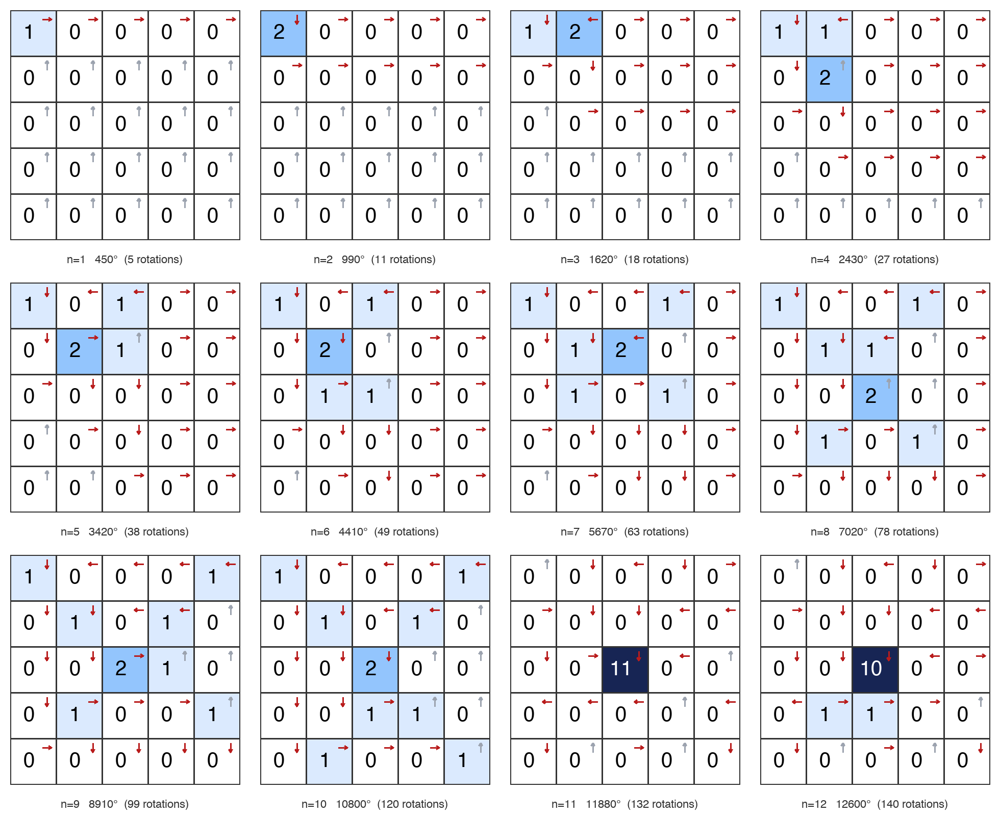

# 十步万度：1 到 12 步的最佳玩法

## 一、12 种最佳玩法的图示

下面 12 张图分别是 n=1 到 12 步的最优点击方案。每格大数字是该格的点击次数，右上角小箭头是点完后该格的最终朝向（灰色表示仍朝上）。单张图片为 `opt_01.png` 到 `opt_12.png`，拼合图为 `opt_all.png`。

| n | 最优点击多重集（行,列） | 旋转数 | 度数 |
|---|---|---|---|
| 1 | (0,0) | 5 | 450 |
| 2 | (0,0)×2 | 11 | 990 |
| 3 | (0,0), (0,1)×2 | 18 | 1620 |
| 4 | (0,0), (0,1), (1,1)×2 | 27 | 2430 |
| 5 | (0,0), (0,2), (1,1)×2, (1,2) | 38 | 3420 |
| 6 | (0,0), (0,2), (1,1)×2, (2,1), (2,2) | 49 | 4410 |
| 7 | (0,0), (0,3), (1,1), (1,2)×2, (2,1), (2,3) | 63 | 5670 |
| 8 | (0,0), (0,3), (1,1), (1,2), (2,2)×2, (3,1), (3,3) | 78 | 7020 |
| 9 | (0,0), (0,4), (1,1), (1,3), (2,2)×2, (2,3), (3,1), (3,4) | 99 | 8910 |
| 10 | (0,0), (0,4), (1,1), (1,3), (2,2)×2, (3,2), (3,3), (4,1), (4,4) | 120 | 10800 |
| 11 | (2,2)×11 | 132 | 11880 |
| 12 | (2,2)×10, (3,1), (3,2) | 140 | 12600 |

n=1 到 4 和 n=8 到 10 各有多个最优解，图中画的是字典序第一个。其余解的情况：n=1 的 5 个解是第一列任意一格；n=2、3、4 的其他解是把图案整体向下平移；n=8、9、10 各有一个以中心为主的第二解，例如 n=10 的另一解是中心 5 次、(2,3) 3 次、(0,0) 与 (4,1) 各 1 次。n=5、6、7、11、12 的最优解唯一。

## 二、关于最佳玩法的几个结论

| n | 1 | 2 | 3 | 4 | 5 | 6 | 7 | 8 | 9 | 10 | 11 | 12 |
|---|---|---|---|---|---|---|---|---|---|---|---|---|
| 最优旋转数 | 5 | 11 | 18 | 27 | 38 | 49 | 63 | 78 | 99 | 120 | 132 | 140 |
| 第 n 步增量 | 5 | 6 | 7 | 9 | 11 | 11 | 14 | 15 | 21 | 21 | 12 | 8 |
| 平均每步 | 5 | 5.5 | 6 | 6.75 | 7.6 | 8.17 | 9 | 9.75 | 11 | 12 | 12 | 11.67 |

- **「十步」选得恰到好处。** 平均每步得分在 n=10 达到峰值 12 次旋转（1080°），n=11 持平，之后下降。第 9 步和第 10 步的边际收益都是 21 次旋转（1890°），是全表最高；第 11 步骤降到 12，第 12 步只剩 8。无论设计者是否有意，10 步正是收益最高的长度。
- **「万度」是刚好够得着的目标。** 10 步最高 10,800°，而在 131,128,140 个 10 步点击多重集中只有 3,725 个达到 10,000°，占比不到十万分之三。
- **最优解不能逐步叠加。** 除 n=1 到 2 外，任何 n 的最优解都不包含在 n+1 的任何最优解里，贪心策略一定失败。n=10 的解里 (0,0)、(0,4)、(4,4) 三个角都要点，而 n=11 的解却是 11 次全点中心。
- **n=10 的终态是一条螺旋。** 点完后 25 个箭头首尾相接，从中心开始顺时针向外盘旋，经过每一格恰好一次，最后从左下角 (4,0) 出界。这是一棵「最长的」生成树，整棵树只有一条路径。
- **次序不改总分，但能改「戏剧性」。** 同样这 10 次点击，若按 (0,0), (0,4), (1,3), (2,2), (2,2), (3,2), (3,3), (4,1), (4,4), (1,1) 的次序，前 9 次只转 31 次，最后一次点击引发连续 89 次旋转，一击 8010°。最平均的次序里单次最长也有 66 次。
- **前 10 步沾了「开局」的光。** 长期来看每步最多只值 $1080/104\approx10.4$ 次旋转（反复点中心，104 次一个周期），而前 10 步能做到 12。多出来的部分来自全朝上的初始棋盘储存的「势能」，也就是分数公式里的 $\tau^{\mathsf T}(p-r)$ 项。
- **解的形状。** n=3 到 10 的最优解都从左上角 (0,0) 出发沿主对角线方向铺开，n=10 的解是一个近似的 X 形：三个角加上两条对角线上的内环格。n=11、12 则完全换成「中心轰炸」。12 步的 140 次旋转恰好与单位元代表 $\sigma_3$ 的旋转数相同，不过只是巧合。

## 三、算法说明：用了穷举，群论决定了搜索空间与理论边界

**算法。** `optimal_search.c` 做一次深度优先搜索：从全朝上出发，按格子编号非递减的顺序依次选择下一个点击的格子，每选一个就在复制的棋盘上模拟连锁、累加旋转数，深度为 d 时更新 d 步的最高分。因为每个深度的分数都在同一次遍历中记录，1 到 12 步的最优解一趟搜完。没有剪枝，也没有用分数公式估界，纯粹是数所有情况。

**次序无关是唯一的省力点，而它正是阿贝尔性质。** 如果按点击序列搜索，10 步有 $25^{10}\approx 9.5\times10^{13}$ 条路径。由于总分只依赖点击多重集，可以规定「编号非递减」只搜一次，数量变成 $\binom{34}{10}\approx1.31\times10^{8}$，缩小了约 70 万倍；12 步时是 $\binom{36}{12}\approx1.25\times10^{9}$，在笔记本上约 50 秒。这一步的合法性就是 PROOF.md 里证明的性质（论文 Lemma 3.9），也是沙堆群能定义出来的前提，但它只是交换幺半群层面的事实，还没用到商群结构。

**群结构用在了理论界而不是程序里。** PROOF.md 第六节的几条结论是从 $\Delta'$ 和群的阶推出来的：

- 精确分数公式 $\text{总度数}=\sum_v\sigma(v)\tau(v)+\tau^{\mathsf T}(p-r)+\sum r$，其中 $\tau=4\Delta'^{-1}\mathbf 1$，后两项有界（$|g|\le 718/13$）。
- 在同一格点 4 次等价于四个邻居各点 1 次且多得 360°，所以最优解里任何非中心格最多点 3 次，非中心点击总数不超过 110。
- 中心的阶是 104，104 次中心点击是单位元且得 97,200°，于是 $n\ge110$ 时 $\mathrm{opt}(n+104)=\mathrm{opt}(n)+1080$，大 $n$ 的最优值由有限多个 $n$ 决定。

这些结论没有写进 DFS 作剪枝，搜索结果只是事后与它们互相印证（例如 12 步内最优解确实没有非中心格超过 3 次，n=11、12 的解符合「中心主导」的渐近行为）。

**群论能不能让搜索更快。** 能，有两个现成的方向。一是用分数公式做分支定界：对部分多重集，剩余 $k$ 步的收益不超过 $k\cdot\max\tau+718/13$，可以提前砍掉大量分支。二是改成在局面上做动态规划：总分由点击多重集的类（即终态箭头图）加上 $\sum_v\sigma(v)\tau(v)$ 决定，所以同一终态只需保留 $\sum_v\sigma(v)\tau(v)$ 最大的那条路径，这是在群元素上做 DP，而非在多重集上枚举。对 5×5 来说穷举已经够快，所以没有实现这两种优化；要算 20 步以上，就需要它们了。
