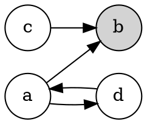
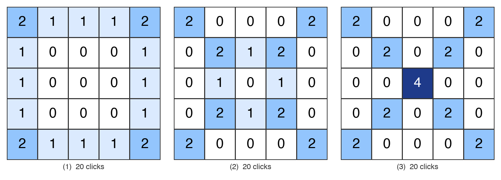

---

**例：一个 4 个顶点的随机有向图**

要求恰有一个顶点出度为 0，且其他顶点都能到达它。随机生成的结果如下（Graphviz dot 代码）：

各点出度：a 为 2，c 为 1，d 为 1，b 为 0。可达性：a 和 c 直接指向 b，d 经 a 到 b。

**邻接矩阵与拉普拉斯矩阵。** 按顶点顺序 $a,b,c,d$。邻接矩阵 $A_{ij}=1$ 表示有边 $i\to j$；拉普拉斯矩阵 $\Delta=D-A$，其中 $D$ 是出度对角矩阵。

$$
A=\begin{pmatrix}
0 & 1 & 0 & 1\\
0 & 0 & 0 & 0\\
0 & 1 & 0 & 0\\
1 & 0 & 0 & 0
\end{pmatrix},
\qquad
D=\begin{pmatrix}
2 & 0 & 0 & 0\\
0 & 0 & 0 & 0\\
0 & 0 & 1 & 0\\
0 & 0 & 0 & 1
\end{pmatrix},
\qquad
\Delta=D-A=\begin{pmatrix}
 2 & -1 &  0 & -1\\
 0 &  0 &  0 &  0\\
 0 & -1 &  1 &  0\\
-1 &  0 &  0 &  1
\end{pmatrix}.
$$

说明：

- 第 2 行（顶点 $b$）全为零，因为 $b$ 是汇点，没有出边。
- 每行的和为零，这是出度拉普拉斯矩阵的特征。
- 删去 $b$ 对应的第 2 行和第 2 列，得到约化拉普拉斯矩阵

$$
\Delta'=\begin{pmatrix}
 2 & 0 & -1\\
 0 & 1 &  0\\
-1 & 0 &  1
\end{pmatrix},
\qquad \det\Delta'=1 .
$$

行列式为 1 意味着这个图以 $b$ 为根的有向生成树只有一棵（$a\to b,\ c\to b,\ d\to a$），沙堆群是平凡群。

---

$\mathbb{Z}^{n-1}$ 是长度为 $n-1$ 的整数向量构成的群，不是方阵。

具体地说：

- $n$ 是图的顶点数，去掉汇点后剩 $n-1$ 个非汇点。
- $\mathbb{Z}^{n-1}$ 的一个元素是 $(\sigma_1,\dots,\sigma_{n-1})$，给每个非汇点记一个整数，也就是一个（允许负数的）筹码配置。群运算是向量逐分量相加，单位元是零向量。
- 对上面的 4 点图，$n=4$，$\mathbb{Z}^{3}$ 的元素就是 $(s_a,s_c,s_d)$ 这样的三元组。

矩阵 $\Delta'$ 出现在被商掉的子群里。$\mathbb{Z}^{n-1}\Delta'$ 表示所有形如 $x\Delta'$ 的向量，其中 $x\in\mathbb{Z}^{n-1}$ 是行向量，$x\Delta'$ 是 $1\times(n-1)$ 乘 $(n-1)\times(n-1)$ 得到的行向量，即 $\Delta'$ 各行的整系数线性组合。这个集合是 $\mathbb{Z}^{n-1}$ 的子群，称为 $\Delta'$ 的行格。

所以

$$
S(G)=\mathbb{Z}^{n-1}\big/\mathbb{Z}^{n-1}\Delta'
$$

读作：筹码配置向量，模掉「发射若干次」所产生的差。两个配置 $\sigma_1,\sigma_2$ 属于同一个群元素，当且仅当 $\sigma_1-\sigma_2=x\Delta'$ 对某个整数向量 $x$ 成立，$x_v$ 的含义正是顶点 $v$ 被发射的净次数。

以 4 点图为例，$\Delta'$ 的三行是 $r_a=(2,0,-1)$，$r_c=(0,2,-1)$，$r_d=(-1,-1,2)$。取 $x=(1,0,1)$，则 $x\Delta'=r_a+r_d=(1,-1,1)$，于是 $(1,0,0)$ 与 $(0,1,-1)$ 是同一个群元素。

方阵的群是另一回事：$n-1$ 阶整数方阵在矩阵加法下也构成群，记作 $M_{n-1}(\mathbb{Z})$ 或 $\mathbb{Z}^{(n-1)\times(n-1)}$，它同构于 $\mathbb{Z}^{(n-1)^2}$，与沙堆群的定义无关。

---

**用新图演示沙堆群的运算**

图：非汇点 $a,b,c$，全局汇点 $d$；边为 $a\leftrightarrow b$，$b\leftrightarrow c$，$a\to d$，$c\to d$。三个非汇点出度都是 2。按 $a,b,c$ 顺序，

$$
\Delta'=\begin{pmatrix} 2&-1&0\\-1&2&-1\\0&-1&2\end{pmatrix},\qquad \det\Delta'=4,
$$

所以沙堆群有 4 个元素，是循环群 $\mathbb{Z}_4$。

**发射规则。** 筹码配置记作 $(s_a,s_b,s_c)$。某点筹码数 $\ge 2$ 时可以发射：$a$ 发射送 1 枚给 $b$、1 枚给 $d$；$b$ 发射送 1 枚给 $a$、1 枚给 $c$；$c$ 发射送 1 枚给 $b$、1 枚给 $d$。送到 $d$ 的筹码消失。

**群元素。** 稳定配置是每点 0 或 1，共 8 个；其中常返的只有 4 个，它们就是群元素：

| 配置 $(s_a,s_b,s_c)$ | 阶 | 说明 |
|---|---|---|
| $(1,0,1)$ | 1 | 单位元 $I$ |
| $(1,1,1)$ | 2 | |
| $(0,1,1)$ | 4 | 生成元，记作 $g$ |
| $(1,1,0)$ | 4 | $g^3=g^{-1}$ |

另外 4 个稳定配置 $(0,0,0),(1,0,0),(0,1,0),(0,0,1)$ 不是常返的，不属于群。

**群运算。** 两个配置逐点相加，然后反复发射直到稳定，记作 $(\sigma+\sigma')^\circ$。下面用 $g=(0,1,1)$ 的幂次把整个群走一遍，箭头上标出发射的点：

$g^2=(g+g)^\circ$：

$$
(0,2,2)\xrightarrow{b}(1,0,3)\xrightarrow{c}(1,1,1).
$$

$g^3=(g^2+g)^\circ$：

$$
(1,2,2)\xrightarrow{b}(2,0,3)\xrightarrow{a}(0,1,3)\xrightarrow{c}(0,2,1)\xrightarrow{b}(1,0,2)\xrightarrow{c}(1,1,0).
$$

$g^4=(g^3+g)^\circ$：

$$
(1,2,1)\xrightarrow{b}(2,0,2)\xrightarrow{a}(0,1,2)\xrightarrow{c}(0,2,0)\xrightarrow{b}(1,0,1)=I.
$$

四次回到单位元，所以 $g$ 的阶是 4，群是 $\mathbb{Z}_4=\{I,g,g^2,g^3\}$。

**再看几条验证。**

- 单位元确实不改变任何元素：$I+g=(1,1,2)\xrightarrow{c}(1,2,0)\xrightarrow{b}(2,0,1)\xrightarrow{a}(0,1,1)=g$。
- 阶 2 元素自乘回到单位元：$(1,1,1)+(1,1,1)=(2,2,2)$，依次发射 $a,b,c,b,a,c,b$ 共 7 次后得 $(1,0,1)=I$。
- 互逆元素相乘：$g+g^3=(0,1,1)+(1,1,0)=(1,2,1)$，稳定化后为 $(1,0,1)=I$，与 $g^4$ 的计算完全一样。

**用矩阵理解。** $\Delta'$ 的三行是 $r_a=(2,-1,0)$，$r_b=(-1,2,-1)$，$r_c=(0,-1,2)$。发射一次 $v$ 就是减去 $r_v$。上面 $g^4$ 的计算共发射了 $a$ 一次、$b$ 两次、$c$ 一次，于是

$$
(1,2,1)-(1,0,1)=(0,2,0)=r_a+2r_b+r_c ,
$$

即 $g^4$ 对应的向量 $4g=(0,4,4)$ 与 $I=(1,0,1)$ 相差一个行格中的向量，二者在商群 $\mathbb{Z}^3/\mathbb{Z}^3\Delta'$ 中是同一个元素。这就是"常返配置上的加法加稳定化"与"整数向量模 $\Delta'$ 行格"两种定义之间的对应。

**与十步万度的对照。** 这个图上的"点击"也可以用转子路由来做：$a$ 的转子在 $b,d$ 两条边间轮换，$b$ 在 $a,c$ 间轮换，$c$ 在 $b,d$ 间轮换。以 $d$ 为根的有向生成树有 $\det\Delta'=4$ 棵，沙堆群在这 4 棵树上自由传递地作用，加筹码算子 $E_a,E_b,E_c$ 生成的转子路由群同构于 $\mathbb{Z}_4$，这就是 Lemma 3.19 在最小非平凡例子上的样子。

---

**问：用沙堆群能否快速计算某个配置最终的稳定状态？比如 $(100,50,25)$，不逐步模拟发射，如何知道它属于哪个等价类？**

可以。沙堆群正是为此而设的：等价类由线性代数一步算出，不需要逐次发射。分三步说。

**第一步：找一个"类函数"。** 沙堆群是 $\mathbb{Z}^3/\mathbb{Z}^3\Delta'$，对这个图它同构于 $\mathbb{Z}_4$，所以存在一个同态 $\varphi:\mathbb{Z}^3\to\mathbb{Z}_4$，其核恰好是 $\Delta'$ 的行格。写 $\varphi(\sigma)=w\cdot\sigma \bmod 4$，要求 $w$ 与 $\Delta'$ 的每一行点积都是 4 的倍数：

$$
r_a=(2,-1,0),\ r_b=(-1,2,-1),\ r_c=(0,-1,2)
\;\Longrightarrow\;
2w_a-w_b\equiv 0,\quad -w_a+2w_b-w_c\equiv 0,\quad -w_b+2w_c\equiv 0 \pmod 4 .
$$

解得 $w=(1,2,3)$，于是

$$
\varphi(s_a,s_b,s_c)=s_a+2s_b+3s_c \pmod 4 .
$$

用四个常返配置核对：$I=(1,0,1)\mapsto 0$，$g=(0,1,1)\mapsto 1$，$g^2=(1,1,1)\mapsto 2$，$g^3=(1,1,0)\mapsto 3$。$\varphi$ 把每个配置直接送到它在 $\mathbb{Z}_4$ 中的元素。

**第二步：对 $(100,50,25)$ 求类。**

$$
\varphi(100,50,25)=100+100+75=275\equiv 3 \pmod 4 ,
$$

所以它属于 $g^3$ 的等价类，这一类里唯一的常返配置是 $(1,1,0)$。

还要确认稳定化的结果就是这个常返配置，而不是同类中某个非常返的稳定配置。判据很简单：$(100,50,25)\ge I=(1,0,1)$ 逐点成立，即它是"单位元加上若干筹码"，而在常返配置上加筹码再稳定化仍是常返的。所以最终稳定配置就是 $(1,1,0)$。模拟验证一致，共发射 284 次。

**第三步：连发射次数也能直接算。** 设 $x_v$ 是 $v$ 的发射次数，则 $\sigma-\sigma^\circ=x\Delta'$，因此

$$
x=(\sigma-\sigma^\circ)\,\Delta'^{-1},\qquad
\Delta'^{-1}=\frac14\begin{pmatrix}3&2&1\\2&4&2\\1&2&3\end{pmatrix}.
$$

代入 $\sigma-\sigma^\circ=(99,49,25)$ 得 $x=(105,111,68)$，总计 284 次，与模拟完全相同。流入汇点的筹码数是 $x_a+x_c=173=175-2$，也对得上。

**一个必要的提醒。** $\varphi$ 给出的是等价类，稳定化结果 $\sigma^\circ$ 只有在 $\sigma$ 逐点不小于某个常返配置时才等于该类的常返代表。例如 $(0,0,0)$ 的类是 0，代表元是 $I=(1,0,1)$，但它本身已经稳定，$\sigma^\circ=(0,0,0)$。筹码总数很少时才会出现这种情况；像 $(100,50,25)$ 这样的大配置不会。

**推广到十步万度。** 5×5 网格的群不是循环群，而是 $\mathbb{Z}_4\oplus\mathbb{Z}_{16}\oplus\mathbb{Z}_{48}\oplus\mathbb{Z}_{102960}^2$，对应的做法是算 $\Delta'$ 的 Smith 标准形 $U\Delta'V=\mathrm{diag}(d_1,\dots,d_{25})$，那么 $\sigma\mapsto \sigma V \bmod (d_1,\dots,d_{25})$ 的最后 5 个分量就是 $\sigma$ 在五个循环因子中的坐标，仍然是一次矩阵乘法加取模。这个图里 $w=(1,2,3)$ 就是 $V$ 对应于 $d=4$ 的那一列。

## 转子路由群的三种理解方式

对 5×5 的「十步万度」，沙堆群 $S(G)=\mathbb{Z}^{25}/\mathbb{Z}^{25}\Delta'$（亦即 Lemma 3.19 的转子路由群）有三种等价的具体描述，都可以直接对着棋盘理解。

### 描述一：点击计数向量模「4 换 4 邻」关系

- **元素**：一个整数向量 $\sigma\in\mathbb{Z}^{25}$，给每格记一个整数，表示这格被点击的净次数，负数表示撤销点击。两个向量视为同一个群元素，当且仅当它们的差是 $\Delta'$ 各行的整系数组合。$\Delta'$ 在 $v$ 的那一行是：$v$ 处 $+4$，$v$ 的每个网格内邻居处 $-1$。所以生成关系只有一条：**在 $v$ 点 4 次 $\sim$ 在 $v$ 的每个网格内邻居各点 1 次**（边角格的邻居少，对应的筹码直接出界丢掉）。
- **运算**：向量逐格相加，即「把两组点击都做一遍」。
- **单位元**：零向量，什么都不点；任何与零等价的向量也是单位元，例如「中心点 104 次」或那张 52 次点击的表 $I$。
- **逆元**：$-\sigma$，即把每次点击撤销。要用正的点击实现它，就利用阶数：中心点 1 次的逆元是中心再点 103 次。

### 描述二：常返筹码配置，配上「相加再倒塌」

这是论文 Corollary 2.16 的说法。每格放 0 到 3 枚筹码的图称为稳定配置；某格达到 4 枚就「倒塌」，向 4 个方向各送一枚，出界的消失。每个群元素在稳定配置中有唯一一个常返代表，单位元的代表就是矩阵 $I$：

$$
I=\begin{pmatrix}
2&3&2&3&2\\
3&2&1&2&3\\
2&1&0&1&2\\
3&2&1&2&3\\
2&3&2&3&2
\end{pmatrix}
$$

运算是：把两张筹码图逐格相加，然后反复倒塌直到稳定。例如「中心点 1 次」这个元素的常返代表是 $I$ 把中心的 0 改成 1，因为 $I+\mathbf 1_{(2,2)}$ 已经稳定。

### 描述三：箭头图本身

这是对本游戏最直观的一种，因为游戏有一个天然的基点：初始的全朝上图 $\rho_0$。由沙堆群在生成树上作用的自由传递性（Lemma 3.13、3.17），$\sigma\mapsto\sigma(\rho_0)$ 是 $S(G)$ 到全部生成树箭头图的双射，所以可以直接说：

- **元素**：游戏中可能出现的每一幅箭头图，共 $\det\Delta'=32{,}565{,}539{,}635{,}200$ 幅。
- **单位元**：全朝上。
- **运算**：设 $\rho_1$ 由点击多重集 $\sigma_1$ 从全朝上得到，则 $\rho_1 * \rho_2 := \sigma_1(\rho_2)$，即「把产生 $\rho_1$ 的那组点击施加到 $\rho_2$ 上」。由 Lemma 3.12 这不依赖 $\sigma_1$ 的选取，由交换性 $\rho_1*\rho_2=\rho_2*\rho_1$。
- **逆元**：把某幅图变回全朝上所需的那组点击对应的图。

举一个最小的例子。从全朝上点中心一次，连锁是中心转向右、(2,3) 转向右、(2,4) 转向右后出界，得到的图 $\rho_c$ 是第 2 行后三格朝右、其余朝上。这幅图就是群元素 $E_{(2,2)}$。它自己连乘 4 次 $\rho_c^{4}$ 等于「四个邻居各点一次」对应的图，连乘 104 次回到全朝上。而 $\rho_c$ 与「角 (0,0) 点一次」的图相乘，就是两处各点一次后的图，先点哪个都一样。

### 三者的关系

描述三里的运算不是能在图上「看出来」的局部操作，它的定义要经过点击。这正是转子路由群与沙堆群同构（Lemma 3.19）的内容：箭头图上的运算和筹码图上的「加法加倒塌」是同一个群的两种坐标，而描述一是它们共同的「代数底层」。

| | 元素 | 运算 | 单位元 |
|---|---|---|---|
| 描述一 | 点击计数向量 $\sigma\in\mathbb{Z}^{25}$，模 $\Delta'$ 的行 | 向量相加 | 零向量（或 $I$、中心 104 次） |
| 描述二 | 常返筹码配置 | 逐格相加后倒塌 | 矩阵 $I$ |
| 描述三 | 箭头图（有根生成树） | 把产生 $\rho_1$ 的点击施加到 $\rho_2$ | 全朝上 |

## 单位元的最少点击代表

问题：找一个非零的点击向量 $\sigma$，使它代表沙堆群的单位元（点完后 25 个箭头全部回到朝上），且总点击次数最少。

**推导。** 单位元的代表是满足 $\sigma=\Delta' x$ 的非负整数向量，$x$ 为整数向量。因为 $\Delta'^{-1}$ 的元素全为正，$\sigma\ge 0$ 且 $\sigma\ne 0$ 迫使 $x\ge 1$。总点击数为

$$
\sum_v \sigma_v=\mathbf 1^{\mathsf T}\Delta' x=\sum_v b_v\,x_v ,
$$

其中 $b_v$ 是格子 $v$ 出界的边数：角格 2，边格 1，内部格 0。所以总数 $\ge 4\cdot 2+12\cdot 1=20$，取等号当且仅当 16 个边界格的 $x_v$ 全为 1。内部 9 格的 $x_v$ 还可以变，枚举后只有 3 组可行。

**结论：最少需要 20 次点击，恰好有 3 个代表。**

$$
\sigma_1=\begin{pmatrix}
2&1&1&1&2\\
1&0&0&0&1\\
1&0&0&0&1\\
1&0&0&0&1\\
2&1&1&1&2
\end{pmatrix},\quad
\sigma_2=\begin{pmatrix}
2&0&0&0&2\\
0&2&1&2&0\\
0&1&0&1&0\\
0&2&1&2&0\\
2&0&0&0&2
\end{pmatrix},\quad
\sigma_3=\begin{pmatrix}
2&0&0&0&2\\
0&2&0&2&0\\
0&0&4&0&0\\
0&2&0&2&0\\
2&0&0&0&2
\end{pmatrix}
$$

**三个解的含义。**

1. $\sigma_1$：四角各点 2 次、其余边格各 1 次，内部不点。这是 $x=\mathbf 1$，即「每格各倒塌一次」，恰好是基本关系 $\Delta'\mathbf 1=b$：所有格各点 4 次等价于只数出界的那些边。它用了 100 次旋转，共 9000°。
2. $\sigma_2$：四角 2 次，内层四角 2 次，内层边中 1 次。对应 $x$ 为边界 1、内部 2。136 次旋转，12240°。
3. $\sigma_3$：四角 2 次，内层四角 2 次，中心 4 次。对应 $x$ 为边界 1、内层 8 格 2、中心 3。140 次旋转，12600°。

三者都经模拟验证：按任意顺序点完后 25 个箭头全部回到朝上。

**与 52 次的 $I$ 的区别。** $I$ 是单位元在常返配置里的唯一代表，用于沙堆群的「相加再倒塌」运算；这里求的是单位元在点击向量里的最省代表。二者是同一个群元素的不同坐标，52 次的 $I$ 并不是最少的。
